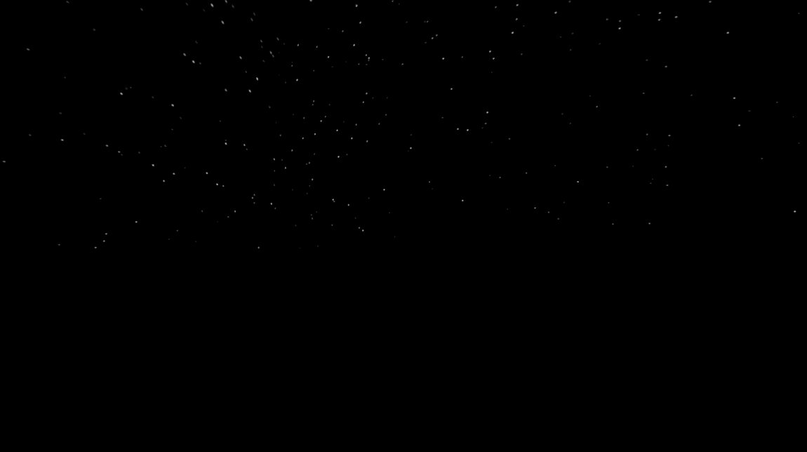
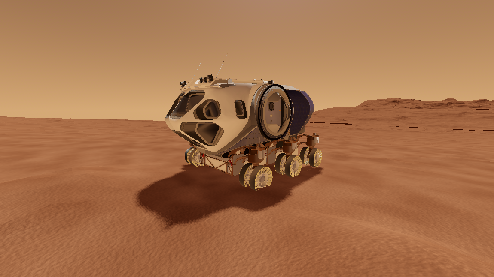
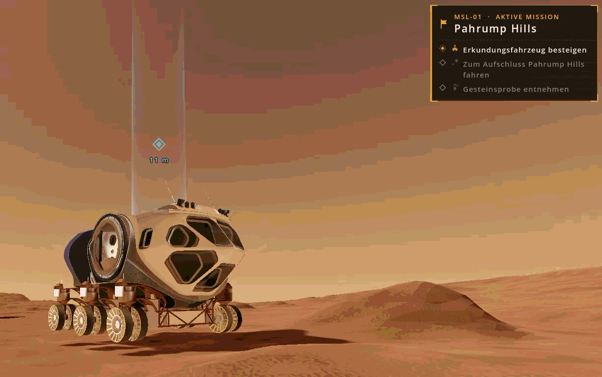

# 🪐 Discover Mars

Discover Mars is a 3D educational game built with Godot. It was created as the practical part of a seminar paper on the question *"How likely is past life on Mars?"*. Players explore real 3D models of the Martian surface, reconstructed from data captured by NASA's rovers and orbiters, travel on foot, by exploration vehicle or by remote-controlled rover, and analyse rock and soil samples based on real findings from the Curiosity and Perseverance missions.

<div align="center">
  
  <div style="display: inline-block; margin-top: 6px; padding: 6px 14px; border-radius: 6px; background-color: #a6a6a7; color: #000000;">
    <em>A sunrise rendered in Discover Mars</em>
  </div>
</div>

## Project Status

The project is complete. It contains three story missions, a full mission interface, a remote-controlled Perseverance rover and a playable Mars environment. A ready-to-run Windows build can be exported with the included export preset.

All in-game text is written in German.

## Features

- First-person and third-person exploration on foot (walk, sprint, crouch, jump, flashlight)
- The **Mars Exploration Vehicle**: drivable with physical suspension and headlights
- The **Perseverance rover**: remote-controlled from anywhere, with spinning and steering wheels and an animated robotic arm for taking samples
- Twelve real 3D terrain tiles (including Gale Crater and Pahrump Hills) with exact collision, smoothed seams between tiles and an invisible world border
- Crashed MAVEN orbiter, Habitat Demonstration Unit and Apollo Lunar Module placed in the world
- A Mars day/night cycle running 100× faster than a real sol, with a Martian sky (butterscotch by day, blue at sunset, stars at night)
- A futuristic light-blue interface: mission tracker, interaction prompts, key hints, and a status bar with speed, Mars local time, gravity and air pressure
- Air pressure following the daily cycle measured by Curiosity's REMS weather station in Gale Crater
- Three story missions with briefings, debriefings, two-page sample analyses and an end screen

<div align="center">
  
  <div style="display: inline-block; margin-top: 6px; padding: 6px 14px; border-radius: 6px; background-color: #a6a6a7; color: #000000;">
    <em>The drivable exploration vehicle on the Martian surface</em>
  </div>
</div>

## The Missions

| Mission | What happens |
| --- | --- |
| **MSN-01 – Signal aus dem Orbit** | Drive the exploration vehicle to the crashed MAVEN orbiter, recover its memory card and view the satellite image at the habitat. It reveals Gale Crater as a former lake. |
| **MSN-02 – Der See im Gale-Krater** | Remote-control Perseverance into Gale Crater, take a rock sample and analyse it at the habitat (data: Curiosity / Mars Science Laboratory). |
| **MSN-03 – Spuren im Gestein** | Drive Perseverance to the Pahrump Hills, take a soil sample and analyse it (data: Perseverance, rock "Cheyava Falls"). |

Each analysis has two pages: first the raw measurements, then their meaning for possible past life. Every analysis names the real mission as its data source and clearly states that the findings are not proof of life. After the last mission, an end screen offers "Spiel beenden" (quit) or "Frei weiterspielen" (free play).

<div align="center">
  
  <div style="display: inline-block; margin-top: 6px; padding: 6px 14px; border-radius: 6px; background-color: #a6a6a7; color: #000000;">
    <em>Animated waypoint marker and mission tracker</em>
  </div>
</div>

## Mission System

Missions are defined in code in `scripts/missions/mission_library.gd` as plain Godot `Resource` types (`Mission`, `MissionObjective`). The `MissionManager` autoload holds the progress, and world nodes advance objectives by calling `MissionManager.report(objective_id)`.

| Node | Purpose |
| --- | --- |
| `mission_waypoint.gd` | Marks a location, draws the beacon and reports arrival (optionally only for a specific vehicle) |
| `mission_interactable.gd` | Reports when the player presses `F` at an object |
| `mission_rover_site.gd` | Sample and analysis zones for the remote-controlled rover |
| `mission_signal_trigger.gd` | Reports when any node emits a given signal |
| `mission_story.gd` | Side effects of objectives: cargo, notifications, satellite image and analyses |
| `mission_director.gd` | Campaign flow: briefing, debriefing, next mission, end screen |

## Controls

| Action | Input |
| --- | --- |
| Move / drive | `W`, `A`, `S`, `D` |
| Look around | Mouse |
| Jump | `Space` |
| Sprint / drive faster (Perseverance) | `Shift` |
| Crouch | `Ctrl` |
| Switch camera | `C` |
| Interact, enter or exit the exploration vehicle, take a sample | `F` |
| Remote-control Perseverance on / off | `R` |
| Flashlight / headlights | `X` |
| Handbrake (exploration vehicle) | `Space` |
| Close info window | `F` or `Esc` |
| Release or capture mouse | `Esc` |

The current keys are also shown in the bottom-left corner of the screen.

## Requirements

- [Godot Engine](https://godotengine.org/) 4.7
- A system capable of running the Forward+ (Vulkan) renderer

## Getting Started

1. Clone or download this repository.
2. Open Godot's Project Manager and import `project.godot`.
3. Run the project with `F5`. The main scene is `main.tscn`.

### Exporting

The project includes a Windows export preset (`export_presets.cfg`) that packs the whole game into a single `.exe` and includes the terrain seam data. Before exporting, disable the Godot AI plugin (Project → Project Settings → Plugins) so its game helper is not included in the build.

### Terrain seams

The height transitions between terrain tiles are precomputed. After moving, adding or removing a tile, regenerate them:

```text
cd tools
npm install @gltf-transform/core @gltf-transform/extensions
node blend_seams.js
```

## Project Structure

```text
.
|-- assets/
|   |-- materials/        # Materials and shaders (terrain, sky, beacon)
|   |-- models/           # 3D models and textures
|   |-- terrain_seams/    # Precomputed tile seam data
|   `-- ui/               # Interface icons and pictures
|-- scripts/
|   |-- missions/         # Mission data, manager and world nodes
|   |-- ui/               # Mission HUD, info window, bottom bar, styling
|   `-- ...               # Rovers, terrain, world border, day/night cycle
|-- tools/                # Terrain seam tool (not part of the game)
|-- main.tscn             # Main scene
|-- player.tscn
|-- exploration_vehicle.tscn
|-- perseverance_rover.tscn
`-- project.godot
```

## Sources and Attribution

The 3D models of the Martian surface, the vehicles, the rovers and the spacecraft were obtained from [NASA's 3D Resources catalog](https://science.nasa.gov/3d-resources/). NASA resources remain subject to the [NASA Images and Media Usage Guidelines](https://www.nasa.gov/nasa-brand-center/images-and-media/). Other third-party assets may have separate attribution and licensing requirements.

Scientific content in the missions is based on:

- NASA/JPL (2013): *NASA Rover Finds Conditions Once Suited for Ancient Life on Mars*
- NASA (2018): *NASA Finds Ancient Organic Material, Mysterious Methane on Mars*
- NASA (2025): *NASA Says Mars Rover Discovered Potential Biosignature Last Year*
- NASA (2015): *NASA Mission Reveals Speed of Solar Wind Stripping Martian Atmosphere*
- Haberle et al. (2014): *Preliminary interpretation of the REMS pressure data from the first 100 sols of the MSL mission*, JGR Planets 119

## License

No project-wide license has been specified. All rights are reserved by the respective copyright holders. Third-party assets may be subject to separate licenses.
